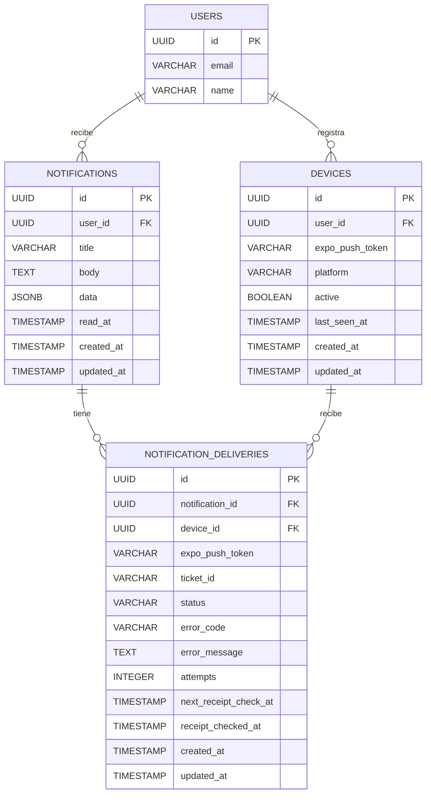
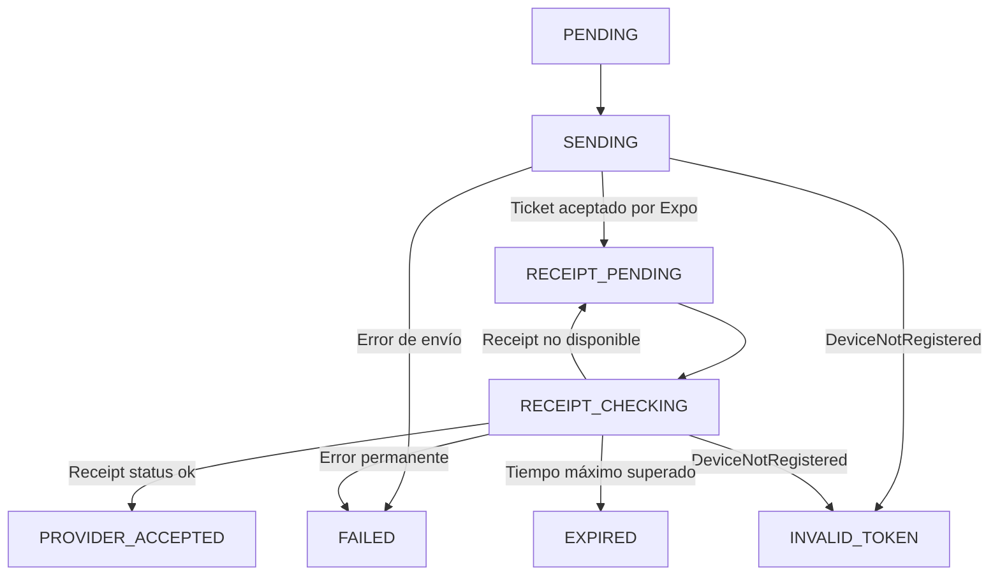

# Sistema completo de notificaciones locales y Push con Expo + Express + TypeScript

## Descripción General

Módulo de notificaciones con arquitectura hexagonal (Ports & Adapters), separando la lógica de negocio de Expo, Firebase y Express.

La solución tendrá dos responsabilidades principales:
•Aplicación móvil: gestionar permisos, tokens, notificaciones locales, recepción de Push, interacciones y navegación.

•Backend Express: registrar dispositivos, generar notificaciones, enviar Push, gestionar suscripciones y mantener un historial de notificaciones.

Utilizaremos Expo Push Service para enviar notificaciones remotas inicialmente. Esto permite trabajar con Expo sin implementar directamente FCM y APNs en el backend.

## Stack tecnológico

Frontend
React Native + Expo + TypeScript

Backend
Node.js + Express + TypeScript

Push
Expo Push Notifications

Persistencia
PostgreSQL + TypeORM

Arquitectura
Hexagonal + Clean Architecture

## Arquitectura general

Primero definimos las responsabilidades y el flujo de comunicación.

El diagrama rquitectura se encuentra en  C:\Users\RUDY PICO\Desktop\noti-rest\ARQUITECTURA DE NOTIFICACIONES.jpg

Principio fundamental: el dominio no debe conocer Expo, Express, PostgreSQL ni Firebase. Solamente debe conocer contratos como NotificationSender o DeviceRepository.

## Estructura del proyecto

Mantener frontend y backend separados, pero utilizar contratos compartidos conceptualmente para evitar inconsistencias en los mensajes.

```
notification-system/
│
├── mobile/
│   ├── app/
│   │   ├── _layout.tsx
│   │   └── notifications/
│   │       └── index.tsx
│   │
│   └── src/
│       ├── core/
│       │   └── config/
│       │       └── environment.ts
│       │
│       ├── domain/
│       │   ├── entities/
│       │   │   └── Notification.ts
│       │   └── ports/
│       │       ├── NotificationGateway.ts
│       │       └── DeviceGateway.ts
│       │
│       ├── application/
│       │   ├── RegisterPushDevice.ts
│       │   ├── ScheduleLocalNotification.ts
│       │   └── HandleNotificationResponse.ts
│       │
│       ├── infrastructure/
│       │   ├── notifications/
│       │   │   ├── ExpoNotificationAdapter.ts
│       │   │   └── NotificationListeners.ts
│       │   └── http/
│       │       └── NotificationApi.ts
│       │
│       ├── presentation/
│       │   ├── providers/
│       │   │   └── NotificationProvider.tsx
│       │   └── hooks/
│       │       └── useNotifications.ts
│       │
│       └── navigation/
│           └── NotificationNavigation.ts
│
└── backend/
    └── src/
        ├── domain/
        │   ├── entities/
        │   │   └── Notification.ts
        │   └── ports/
        │       ├── NotificationRepository.ts
        │       ├── DeviceRepository.ts
        │       └── NotificationSender.ts
        │
        ├── application/
        │   ├── use-cases/
        │   │   ├── RegisterDevice.ts
        │   │   ├── SendNotification.ts
        │   │   ├── MarkAsRead.ts
        │   │   └── DeactivateDevice.ts
        │   └── dto/
        │
        ├── infrastructure/
        │   ├── database/
        │   │   ├── entities/
        │   │   └── repositories/
        │   └── push/
        │       └── ExpoPushAdapter.ts
        │
        ├── presentation/
        │   ├── controllers/
        │   ├── routes/
        │   └── middlewares/
        │
        ├── config/
        └── main.ts
```

La regla de dependencia será:

```
Presentation → Application → Domain
Infrastructure → Domain
```

El dominio define los contratos. La infraestructura los implementa. Los casos de uso coordinan las operaciones.

## Base de datos

Para gestionar correctamente el ciclo de vida de las notificaciones, necesitaremos **tres tablas principales**:

1. **`devices`**: registra los dispositivos asociados a cada usuario y almacena sus tokens de Expo Push.
2. **`notifications`**: mantiene el historial de notificaciones que recibe cada usuario, incluyendo su contenido y estado de lectura.
3. **`notification_deliveries`**: registra el proceso y resultado del envío de cada notificación a cada dispositivo.

Esta separación permite que una misma notificación se envíe a varios dispositivos y que cada entrega tenga su propio estado, errores y seguimiento.

Por ejemplo, si un usuario tiene cinco dispositivos registrados, una notificación generará cinco registros en `notification_deliveries`. Tres pueden finalizar correctamente y dos pueden fallar, sin perder el historial general de la notificación.

> **Importante:** `DeliveryStatus` no es una tabla, sino un enumerado (`ENUM`) que define los posibles estados de cada entrega.

### Modelo relacional



### Descripción de las relaciones

| Relación | Cardinalidad | Descripción |
|---|---|---|
| `USERS → DEVICES` | 1:N | Un usuario puede registrar varios dispositivos. |
| `USERS → NOTIFICATIONS` | 1:N | Un usuario puede recibir múltiples notificaciones. |
| `NOTIFICATIONS → NOTIFICATION_DELIVERIES` | 1:N | Una notificación puede generar múltiples entregas, una por dispositivo. |
| `DEVICES → NOTIFICATION_DELIVERIES` | 1:N | Un dispositivo puede recibir múltiples notificaciones a lo largo del tiempo. |

### Descripción de las tablas

#### 1. `devices`

Almacena los dispositivos registrados por cada usuario. Cada dispositivo tiene un token de Expo Push que permite identificarlo como destino de una notificación.

| Campo | Tipo | Descripción |
|---|---|---|
| `id` | UUID | Identificador único del dispositivo. |
| `user_id` | UUID | Usuario propietario del dispositivo. |
| `expo_push_token` | VARCHAR | Token utilizado por Expo para enviar notificaciones push. |
| `platform` | VARCHAR | Plataforma del dispositivo: Android o iOS. |
| `active` | BOOLEAN | Indica si el dispositivo está habilitado para recibir notificaciones. |
| `last_seen_at` | TIMESTAMP | Última actividad o actualización del dispositivo. |
| `created_at` | TIMESTAMP | Fecha de registro. |
| `updated_at` | TIMESTAMP | Fecha de última actualización. |

**Consideraciones:**
- Un usuario puede tener varios dispositivos registrados.
- Cuando el usuario cierra sesión o el token deja de ser válido, el dispositivo puede desactivarse.
- Si Expo devuelve el error `DeviceNotRegistered`, el token debe marcarse como inactivo.
- Los tokens pueden cambiar, por lo que el cliente debe actualizar su registro cuando obtenga uno nuevo.

#### 2. `notifications`

Almacena el historial de notificaciones asociadas a cada usuario. Representa la notificación lógica, independientemente de cuántos dispositivos tenga el usuario.

| Campo | Tipo | Descripción |
|---|---|---|
| `id` | UUID | Identificador único de la notificación. |
| `user_id` | UUID | Usuario que recibe la notificación. |
| `title` | VARCHAR | Título de la notificación. |
| `body` | TEXT | Contenido o mensaje de la notificación. |
| `data` | JSONB | Información adicional para la navegación o lógica de la aplicación. |
| `read_at` | TIMESTAMP | Fecha y hora en que el usuario leyó la notificación. |
| `created_at` | TIMESTAMP | Fecha de creación. |
| `updated_at` | TIMESTAMP | Fecha de última actualización. |

**Consideraciones:**
- Permite mantener un historial de notificaciones por usuario.
- `data` almacena información adicional en formato JSONB.
- `read_at` permite conocer el estado de lectura. Si es `NULL`, todavía no se ha leído.
- La lectura pertenece a la notificación del usuario, no a cada dispositivo individual.
- Una notificación puede existir aunque el usuario no tenga dispositivos registrados o el envío push falle.

#### 3. `notification_deliveries`

Registra el resultado individual del envío de una notificación a cada dispositivo. Esta tabla es fundamental para controlar los tickets, receipts, errores y reintentos del servicio de Expo Push.

| Campo | Tipo | Descripción |
|---|---|---|
| `id` | UUID | Identificador único de la entrega. |
| `notification_id` | UUID | Notificación a la que pertenece la entrega. |
| `device_id` | UUID | Dispositivo destinatario. |
| `expo_push_token` | VARCHAR | Copia del token utilizado al realizar el envío. |
| `ticket_id` | VARCHAR | Identificador del ticket devuelto por Expo. |
| `status` | VARCHAR | Estado actual del proceso de entrega. |
| `error_code` | VARCHAR | Código del error devuelto por Expo, si existe. |
| `error_message` | TEXT | Descripción del error. |
| `attempts` | INTEGER | Número de intentos de envío o procesamiento, según la política definida. |
| `next_receipt_check_at` | TIMESTAMP | Fecha programada para consultar el receipt. |
| `receipt_checked_at` | TIMESTAMP | Fecha de la última consulta del receipt. |
| `created_at` | TIMESTAMP | Fecha de creación del registro de entrega. |
| `updated_at` | TIMESTAMP | Fecha de última actualización. |

**Consideraciones:**
- Cada dispositivo destinatario genera un registro independiente.
- `ticket_id` permite consultar posteriormente el receipt correspondiente en Expo.
- `expo_push_token` conserva el token utilizado en ese envío, incluso si posteriormente cambia en la tabla `devices`.
- `next_receipt_check_at` permite programar consultas pendientes.
- `error_code` y `error_message` permiten identificar y diagnosticar fallos.
- Los estados de las entregas permiten calcular el resultado general de una notificación.

### Estados de una entrega: `DeliveryStatus`

El estado se almacena en `notification_deliveries.status` y representa la evolución del envío a un dispositivo.

| Estado | Descripción |
|---|---|
| `PENDING` | La entrega está registrada y pendiente de envío. |
| `SENDING` | El sistema está intentando enviar la notificación a Expo. |
| `RECEIPT_PENDING` | Expo aceptó el mensaje y se espera consultar su receipt. |
| `RECEIPT_CHECKING` | El sistema está consultando el receipt en Expo. |
| `PROVIDER_ACCEPTED` | El proveedor de notificaciones aceptó el mensaje para su entrega. |
| `FAILED` | El envío o procesamiento terminó con un error. |
| `INVALID_TOKEN` | El token del dispositivo no es válido o ya no está registrado. |
| `EXPIRED` | El proceso de consulta del receipt superó el tiempo máximo establecido. |

**Flujo general de estados:**



Los estados `PROVIDER_ACCEPTED`, `FAILED`, `INVALID_TOKEN` y `EXPIRED` representan resultados finales del procesamiento de esa entrega.

**Importante sobre los receipts de Expo:**

Hay que diferenciar tres momentos:

1. **Ticket:** Expo acepta la solicitud de envío y devuelve un identificador (`ticket_id`). Esto no significa que el dispositivo haya recibido la notificación.
2. **Receipt:** permite conocer si el proveedor de notificaciones (FCM o APNs) aceptó el mensaje para su entrega.
3. **Recepción en el dispositivo:** el receipt no garantiza que la notificación haya aparecido en el dispositivo ni que el usuario la haya visto.

Por esta razón, `PROVIDER_ACCEPTED` significa que el proveedor aceptó el mensaje, no que exista una confirmación de visualización por parte del dispositivo.

### Estados generales de una notificación

Además del estado individual de cada entrega, podemos calcular un estado general para la notificación.

Este estado no necesita almacenarse obligatoriamente en `notifications`, ya que puede calcularse a partir de los registros de `notification_deliveries`.

| Estado general | Descripción |
|---|---|
| `PENDING` | La notificación todavía no ha comenzado a procesarse. |
| `PROCESSING` | Existen entregas pendientes o en proceso. |
| `COMPLETED` | Todas las entregas finalizaron con aceptación del proveedor. |
| `PARTIALLY_FAILED` | Algunas entregas finalizaron correctamente y otras fallaron. |
| `FAILED` | Todas las entregas terminaron con error. |

El estado general permite consultar rápidamente el resultado del envío sin perder el detalle individual de cada dispositivo.

### Consideraciones de diseño

- **users:** almacena la información básica de los usuarios.
- **devices:** permite registrar varios dispositivos por usuario para enviar notificaciones push mediante Expo.
- **notifications:** mantiene el historial de notificaciones asociadas a cada usuario.
- **notification_deliveries:** permite controlar individualmente cada envío a un dispositivo.
- **expo_push_token:** identifica el destino de las notificaciones push.
- **platform:** permite identificar si el dispositivo utiliza Android o iOS.
- **active:** permite habilitar o deshabilitar un dispositivo.
- **data:** almacena información adicional en formato JSONB.
- **read_at:** almacena la fecha y hora en que el usuario leyó la notificación.
- **ticket_id:** permite relacionar la respuesta inicial de Expo con la consulta posterior del receipt.
- **status:** permite conocer el estado actual de cada entrega.
- **error_code y error_message:** permiten registrar y diagnosticar errores.
- **next_receipt_check_at:** permite programar la consulta de receipts pendientes.
- **attempts:** permite controlar los intentos y aplicar políticas de reintento.

### Índices y restricciones recomendados

Para mantener un buen rendimiento y evitar inconsistencias, se recomienda implementar los siguientes índices:

| Tabla | Índice o restricción | Propósito |
|---|---|---|
| `devices` | `INDEX(user_id)` | Consultar los dispositivos de un usuario. |
| `devices` | `UNIQUE(expo_push_token)` | Evitar registrar el mismo token en múltiples dispositivos activos. |
| `notifications` | `INDEX(user_id, created_at)` | Consultar el historial de notificaciones de un usuario. |
| `notification_deliveries` | `INDEX(notification_id)` | Consultar las entregas de una notificación. |
| `notification_deliveries` | `INDEX(device_id)` | Consultar el historial de entregas de un dispositivo. |
| `notification_deliveries` | `INDEX(status, next_receipt_check_at)` | Encontrar las entregas pendientes de consultar. |
| `notification_deliveries` | `UNIQUE(ticket_id)` | Evitar asociar un ticket de Expo a más de una entrega, permitiendo valores NULL. |

También se recomienda:

- Utilizar claves foráneas para mantener la integridad referencial.
- Definir una política de eliminación coherente: por ejemplo, eliminar en cascada las entregas al eliminar una notificación.
- Considerar índices parciales para dispositivos activos y entregas pendientes.
- Implementar el procesamiento de receipts mediante transacciones y bloqueo de registros para evitar que varios workers procesen simultáneamente la misma entrega.
- No exponer los tokens de Expo en los endpoints que devuelven el historial de notificaciones.

### Flujo de persistencia de una notificación

1. Se crea el registro en `notifications`, asociado al usuario destinatario.
2. Se consultan los dispositivos activos del usuario en `devices`.
3. Se crea un registro en `notification_deliveries` por cada dispositivo.
4. Se envían los mensajes a Expo Push Service.
5. Se guarda el `ticket_id` devuelto por Expo y se programa la consulta del receipt.
6. Después del tiempo recomendado, el worker consulta los receipts de Expo.
7. Se actualiza el estado de cada entrega según el resultado obtenido.
8. Si el token devuelve `DeviceNotRegistered`, se desactiva el dispositivo.
9. Si corresponde, se programan reintentos para los errores recuperables.
10. Se calcula el estado general de la notificación a partir de sus entregas.

**Nota:** Expo recomienda esperar aproximadamente 15 minutos antes de consultar los receipts. Los receipts se conservan durante un periodo limitado, por lo que deben consultarse dentro de esa ventana. Un receipt exitoso tampoco garantiza que el usuario haya visto la notificación.

### Consideración sobre las notificaciones locales

Las notificaciones locales se programan y gestionan directamente en el dispositivo mediante `expo-notifications`. No pasan por Expo Push Service y, por tanto, no generan tickets ni receipts en el backend.

Las tablas descritas en esta documentación están orientadas principalmente a las notificaciones remotas (Push). Si posteriormente necesitamos sincronizar el historial de notificaciones locales, será necesario definir un mecanismo adicional de comunicación entre el cliente y el backend.

## mobile

!!!
Las notificaciones Push remotas necesitan un development build. Expo Go no es el entorno adecuado para probar esta funcionali.dad

### Android

Necesitas configurar Firebase Cloud Messaging V1:

1. Entra en Firebase Console.
2. Crea un proyecto.
3. Registra tu aplicación Android con el mismo package del app.json.
4. Configura Firebase Cloud Messaging.
5. Genera una cuenta de servicio para FCM V1.
6. Entra en tu proyecto de Expo y configura las credenciales FCM V1 mediante EAS.

Los canales deben configurarse antes de solicitar el token Push en Android.

### Gestionar eventos del ciclo de vida

Este es uno de los puntos más importantes.

Necesitas escuchar:

- Notificación recibida.
- Usuario interactúa con una notificación.
- Usuario abre una notificación con la aplicación cerrada.
- Cambio de permisos.
- Limpieza de listeners.

### Gestionar notificaciones en segundo plano

Hay una diferencia importante entre recibir una notificación visible y ejecutar código JavaScript en segundo plano.

Para las notificaciones normales:

- Android puede mostrar el mensaje mientras la aplicación está cerrada.
- El sistema operativo se encarga de mostrarlo.
- Cuando el usuario toca el aviso, la aplicación se abre.

## CONFIGURACIÓN Y PRUEBAS

```
npm install -g eas-cli

eas login

eas build:configure
```

Crea un archivo eas.json:

```


{
  "build": {
    "development": {
      "developmentClient": true,
      "distribution": "internal"
    },
    "preview": {
      "distribution": "internal"
    },
    "production": {}
  }
}

```

Construcción Android:

```

eas build --profile development --platform android

```

Después de instalar el development build:

```

npx expo start --dev-client

```

## Probar el backend

Primero registra el token que obtuviste desde la aplicación.

```

POST /api/devices/register
Authorization: Bearer TU_JWT
Content-Type: application/json

```

```
{
  "token": "ExponentPushToken[TU_TOKEN]",
  "platform": "android"
}

```

envía una notificación:

```

POST /api/notifications/send
Authorization: Bearer TU_JWT_ADMIN
Content-Type: application/json

```

El dispositivo recibirá el mensaje y el listener procesará el evento correspondiente.

## El ciclo completo y sus estados

Debes separar los estados de la aplicación de los estados de la notificación.


Estados de la aplicación:

```

FOREGROUND
BACKGROUND
TERMINATED

```

Estados de una notificación en el backend:

```
PENDING
   |
   v
SENDING
   |
   v
ACCEPTED
   |
   v
PROVIDER_ACCEPTED
   |
   v
READ

```


PROVIDER_ACCEPTED indica que el servicio de Apple o Google aceptó el mensaje según el receipt de Expo. No demuestra que la persona lo haya visto.

Para implementar correctamente el ciclo completo, añade un proceso de consulta de receipts:

1. Almacenar el ticket devuelto por Expo.
2. Esperar aproximadamente 15 minutos.
3. Consultar los receipts en lotes de hasta 1000 identificadores.
4. Actualizar el estado.
5. Si aparece DeviceNotRegistered, desactivar ese token.
6. Reintentar únicamente errores transitorios con backoff exponencial.
Expo recomienda esta comprobación porque aceptar una notificación no significa que haya llegado al dispositivo


## Mejoras necesarias antes de producción
Te recomiendo priorizar estas cinco mejoras:

1. Idempotencia: utiliza un identificador único por evento para evitar notificaciones duplicadas.
2. Outbox Pattern: registra el evento de negocio y su intención de notificación dentro de una transacción. Un worker independiente realiza el envío.
3. Procesamiento asíncrono: incorpora RabbitMQ o Redis cuando aumente el volumen.
4. Receipts: implementa un worker para consultar los resultados de Expo.
5. Seguridad: valida usuarios, permisos, tokens, payloads y límites de envío.


